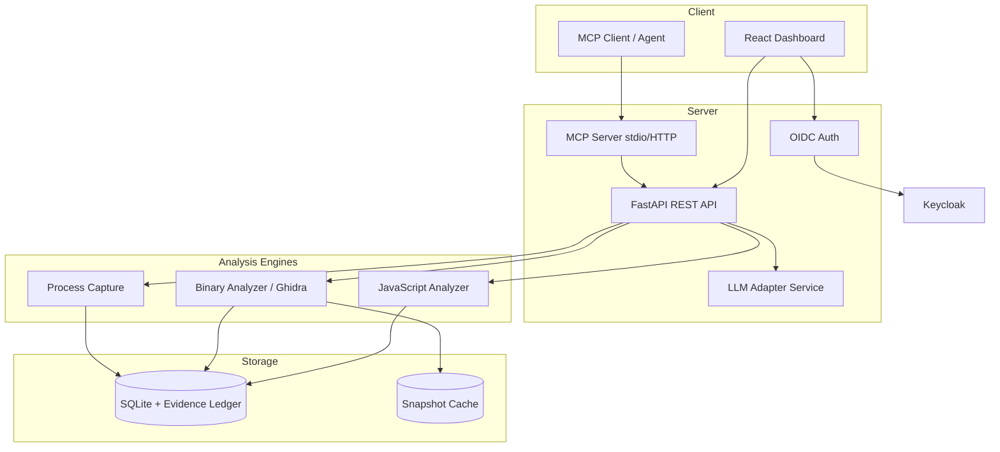

# Vector Forge

> Work in progress. This checkpoint may be incomplete or fail tests. See PLAN.md and STATUS.md before use.


**Alan Vo | AI & Machine Learning**

Reverse engineer anything with agents, from app behavior down to native binaries.

Vector Forge is an MCP (Model Context Protocol) server and web application that enables AI agents and analysts to reverse engineer software across multiple domains: JavaScript/TypeScript applications, native binaries (via Ghidra), and runtime process behavior. It provides a unified evidence ledger with deterministic algorithms, cancellation support, and resource-bounded execution.

## Features

- **MCP Server**: JSON-RPC 2.0 over stdio/HTTP for AI agent integration
- **JavaScript/TypeScript Analysis**: AST parsing, call graphs, import/export tracking
- **Evidence Ledger**: Persistent SQLite storage with full provenance and relationships
- **Binary Analysis**: Ghidra headless integration (planned)
- **Process Capture**: PTY-based execution tracing and comparison (planned)
- **Web Dashboard**: React + TypeScript frontend for session management
- **Authentication**: OIDC with Keycloak, role-based access control
- **LLM Adapters**: Multi-provider support for advisory explanations (planned)

## Architecture



## Quick Start

### Prerequisites

- Docker and Docker Compose
- Node.js 24+ (for frontend development)
- Python 3.12+ (for backend development)
- Ghidra (for binary analysis, bring your own)

### Using Docker Compose (Recommended)

```bash
# Copy environment template
cp .env.example .env

# Start all services
docker compose up --build

# Services available at:
# - Frontend: http://localhost:8080
# - Backend API: http://localhost:8000
# - API Docs: http://localhost:8000/docs
# - Keycloak: http://localhost:8081 (admin/admin)
# - MCP HTTP: http://localhost:8000/mcp
```

### Local Development

**Backend:**
```bash
cd backend
python -m venv .venv
source .venv/bin/activate
pip install -r requirements.txt
cp ../.env.example .env  # Edit as needed
PYTHONPATH=. uvicorn app.main:app --reload --host 127.0.0.1 --port 8000
```

**Frontend:**
```bash
cd frontend
npm install
npm run dev  # Runs on http://localhost:5173
```

**Run Tests:**
```bash
# Backend tests
cd backend
PYTHONPATH=. python -m pytest tests/ -v

# Frontend tests
cd frontend
npm test
```

## MCP Tools

Vector Forge exposes the following MCP tools for AI agents:

| Tool | Description |
|------|-------------|
| `analyze_javascript_application` | Analyze JS/TS directory, extract functions, calls, imports |
| `binary_session` | Create binary analysis session with Ghidra |
| `binary_overview` | Get binary overview: segments, functions, imports |
| `cancel_analysis` | Cancel running analysis by session ID |
| `get_evidence` | Get evidence record by ID with optional edges |
| `search_evidence` | Search evidence by name within a session |

### Example MCP Usage

```json
{
  "jsonrpc": "2.0",
  "id": 1,
  "method": "tools/call",
  "params": {
    "name": "analyze_javascript_application",
    "arguments": {
      "input_path": "/absolute/path/to/project",
      "format": "directory",
      "max_files": 1000
    }
  }
}
```

## API Endpoints

### Sessions
- `POST /api/v1/sessions` - Create new analysis session
- `GET /api/v1/sessions` - List sessions (paginated, filtered)
- `GET /api/v1/sessions/{id}` - Get session details
- `PATCH /api/v1/sessions/{id}/status` - Update session status

### Evidence
- `GET /api/v1/sessions/{id}/evidence` - List evidence (paginated, filtered)
- `GET /api/v1/sessions/{id}/evidence/{evidence_id}` - Get evidence with optional edges
- `GET /api/v1/sessions/{id}/evidence/{evidence_id}/callers` - Get function callers
- `GET /api/v1/sessions/{id}/evidence/{evidence_id}/callees` - Get function callees
- `GET /api/v1/sessions/{id}/evidence/{evidence_id}/imports` - Get imports
- `GET /api/v1/sessions/{id}/export` - Export session as JSON

### Health
- `GET /health` - Health check
- `GET /health/ready` - Readiness check

## Configuration

All configuration via environment variables (see `.env.example`):

| Variable | Description | Default |
|----------|-------------|---------|
| `DATABASE_URL` | SQLite database URL | `sqlite+aiosqlite:///./data/vector_forge.db` |
| `MCP_TRANSPORT` | MCP transport mode | `http` |
| `DEMO_MODE` | Enable localhost-only demo auth | `true` |
| `OIDC_ISSUER_URL` | Keycloak issuer URL | (required for production) |
| `LLM_PROVIDER` | LLM provider type | `openai-compatible` |
| `MAX_ANALYSIS_TIME_SECONDS` | Analysis timeout | `300` |

## Authentication

### Demo Mode (Development)
- Enabled by default (`DEMO_MODE=true`)
- Only allows connections from `127.0.0.1`, `localhost`, `::1`
- Creates a demo user with `viewer` and `operator` roles
- **Never enable in production**

### Production (OIDC/Keycloak)
1. Configure Keycloak realm with `vector-forge` client
2. Set `OIDC_ISSUER_URL`, `OIDC_CLIENT_ID`, `OIDC_CLIENT_SECRET`
3. Set `DEMO_MODE=false`
4. Configure redirect URI: `https://your-domain.com/auth/callback`
5. Assign roles: `viewer`, `operator`, `admin`

### Roles
- `viewer`: Read-only access to sessions and evidence
- `operator`: Create sessions, run analyses, export data
- `admin`: Full access including user management (future)

## LLM Providers

Vector Forge supports multiple LLM providers for advisory explanations (opt-in, labeled advisory):

| Provider | Configuration |
|----------|---------------|
| OpenAI-compatible | `LLM_PROVIDER=openai-compatible`, `LLM_BASE_URL`, `LLM_API_KEY` |
| Anthropic | `LLM_PROVIDER=anthropic`, `LLM_API_KEY` |
| Gemini | `LLM_PROVIDER=gemini`, `LLM_API_KEY` |
| Ollama | `LLM_PROVIDER=ollama`, `LLM_BASE_URL=http://localhost:11434` |

**Security**: API keys only stored server-side. Explanations are grounded in actual evidence records with clear provider errors.

## Backup & Restore

```bash
# Backup SQLite database
docker compose exec backend cp /app/data/vector_forge.db /app/data/backup-$(date +%Y%m%d).db

# Restore
docker compose exec backend cp /app/data/backup-20240101.db /app/data/vector_forge.db
```

## TLS Reverse Proxy

For production, deploy behind a TLS-terminating reverse proxy (nginx, Traefik, Caddy):

```nginx
# Example nginx config
server {
    listen 443 ssl http2;
    server_name your-domain.com;
    
    ssl_certificate /path/to/cert.pem;
    ssl_certificate_key /path/to/key.pem;
    
    location / {
        proxy_pass http://backend:8000;
        proxy_set_header Host $host;
        proxy_set_header X-Real-IP $remote_addr;
        proxy_set_header X-Forwarded-For $proxy_add_x_forwarded_for;
        proxy_set_header X-Forwarded-Proto $scheme;
    }
}
```

## Development

### Project Structure

```
vector-forge/
├── backend/
│   ├── app/
│   │   ├── api/           # FastAPI routes
│   │   ├── core/          # Config, database, security
│   │   ├── models/        # SQLAlchemy models
│   │   ├── services/      # Business logic
│   │   ├── mcp/           # MCP server implementation
│   │   └── analysis/      # Analysis engines
│   ├── tests/             # Pytest tests
│   └── Dockerfile
├── frontend/
│   ├── src/
│   │   ├── components/    # React components
│   │   ├── api/           # API client
│   │   └── __tests__/     # Vitest tests
│   └── Dockerfile
├── compose.yaml
├── .env.example
└── README.md
```

### Adding New Analysis Tools

1. Create parser in `backend/app/analysis/<domain>/parser.py`
2. Create evidence converter in `backend/app/analysis/<domain>/evidence.py`
3. Create tool handler in `backend/app/analysis/<domain>/tool.py`
4. Register MCP tool in `backend/app/mcp/tools.py`
5. Add API endpoints in `backend/app/api/evidence.py`
6. Add frontend components in `frontend/src/components/`

## AI/ML Evaluation

Vector Forge's core AI/ML value is in **deterministic reverse engineering algorithms** that produce structured evidence for agent consumption. The JavaScript analyzer uses regex-based AST extraction (production would use tree-sitter or esprima) to build call graphs and dependency maps.

**Reproducible Baseline:**
```bash
# Create test fixture
mkdir -p test_fixture
cat > test_fixture/main.js << 'EOF'
function hello() { return 'world'; }
async function fetchData() { return await fetch('/api'); }
class User { constructor(name) { this.name = name; } }
import React from 'react';
export { hello, fetchData };
EOF

# Analyze via API
curl -X POST http://localhost:8000/api/v1/sessions \
  -H "Content-Type: application/json" \
  -d '{"session_type": "javascript", "target_path": "/absolute/path/to/test_fixture"}'

# Query evidence
curl http://localhost:8000/api/v1/sessions/{session_id}/evidence
```

**Limitations:**
- Regex-based JS parsing misses dynamic features (eval, dynamic imports)
- No TypeScript type resolution
- Binary analysis requires Ghidra installation
- Process capture Linux-only (PTY)
- LLM explanations are advisory only, not authoritative

## Security Limitations

- Demo mode only for localhost development
- No encryption at rest for SQLite (file permissions only)
- MCP stdio transport has no authentication
- Ghidra runs as subprocess with user privileges
- LLM API keys in memory only, not logged
- No audit logging of evidence access (planned)

## License

MIT License - Copyright (c) 2024 Alan Vo <alanvo@gmail.com>

See [LICENSE](LICENSE) for details.